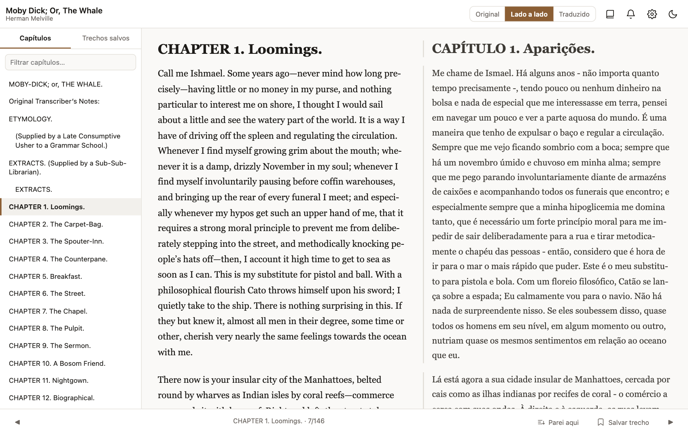
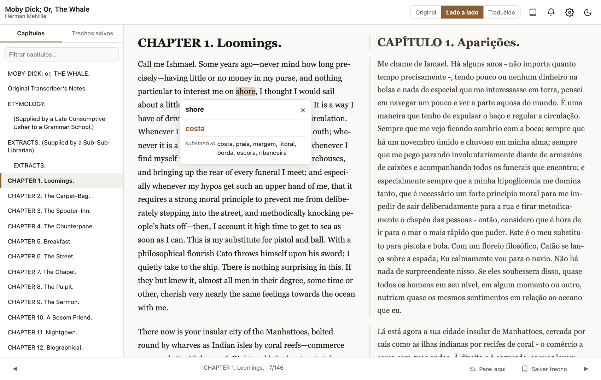
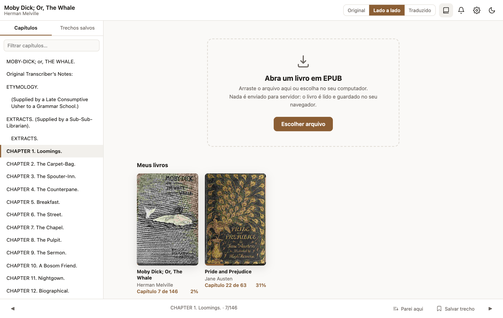
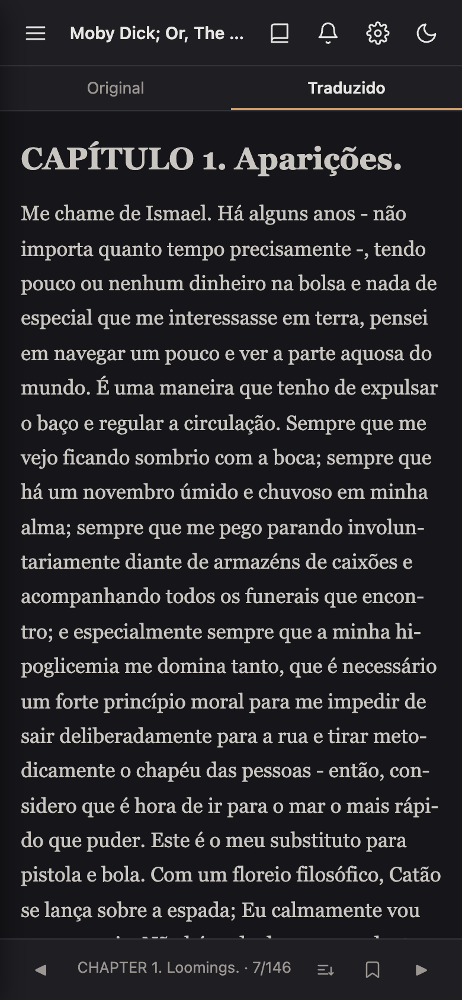

<div align="center">

# 📖 EPUB Reader

**Leia livros em outro idioma com a tradução ao lado, parágrafo por parágrafo.**

Gratuito, sem cadastro e sem instalar nada. Roda direto no navegador, e seus
livros ficam guardados só no seu computador.

[**Abrir o app →**](https://fabiotrindade.github.io/epub-reader/)
&nbsp;·&nbsp; [Como usar](#como-usar)
&nbsp;·&nbsp; [Privacidade](#privacidade)
&nbsp;·&nbsp; [Livros gratuitos](#onde-encontrar-livros-gratuitos)
&nbsp;·&nbsp; [Dúvidas](#perguntas-frequentes)

[](LICENSE)




</div>

## Destaques

- **Tradução ao lado do original.** Cada parágrafo traduzido fica alinhado com
  o original. Você lê no idioma do livro e só olha a tradução quando precisa.
- **Dicionário com um clique.** Clique numa palavra para ver a tradução, a
  classe gramatical e outros sentidos.
- **Volta exatamente onde você parou.** Marque a frase em que parou de ler, e o
  livro reabre nela, mesmo que você mude o tamanho da letra ou a janela.
- **Seus livros não são enviados para nenhum servidor.** O arquivo é lido e
  guardado no próprio navegador. [Veja o que sai e o que fica](#privacidade).
- **Gratuito de verdade.** Sem conta, sem anúncios, sem plano pago. O código é
  aberto, sob a licença MIT.

## Como usar

1. Abra **[fabiotrindade.github.io/epub-reader](https://fabiotrindade.github.io/epub-reader/)**
   no navegador do computador ou do celular.
2. Arraste um arquivo `.epub` para a página ou clique em **Escolher arquivo**.
3. Escolha um capítulo no sumário à esquerda. A tradução começa sozinha.

> **Dica:** a primeira página de quase todo livro é a capa, que só tem imagem e
> nada para traduzir. Se nada mudou, escolha o primeiro capítulo no sumário.

Não tem um EPUB à mão? Veja [onde encontrar livros gratuitos](#onde-encontrar-livros-gratuitos).

### Modos de leitura

Os três botões no topo da tela escolhem o que aparece:

| Modo | O que mostra |
|---|---|
| **Original** | Só o texto do livro. Nenhuma tradução é feita. |
| **Lado a lado** | Original à esquerda, tradução à direita, parágrafo por parágrafo. É o modo padrão. |
| **Traduzido** | Só a tradução. |

O modo escolhido fica salvo. Um capítulo traduzido uma vez fica guardado no
navegador e aparece na hora quando você volta a ele, sem gastar internet.

O idioma do livro é detectado automaticamente. O idioma da tradução pode ser
português do Brasil (padrão), português de Portugal, espanhol, francês, alemão
ou italiano.

### Dicionário

Clique em qualquer palavra do texto original para abrir um pequeno verbete com a
tradução principal e os sentidos agrupados por classe gramatical. Feche com
`Esc` ou clicando fora dele. Selecionar um trecho arrastando o mouse não abre o
dicionário, então dá para marcar texto normalmente.



### Marcar onde parou e salvar trechos

São duas marcas diferentes, cada uma com um visual próprio:

| | **Parei aqui** | **Salvar trecho** |
|---|---|---|
| Para quê | Saber onde continuar a leitura | Guardar passagens que você quer rever |
| Quantas | Uma por livro (ela se move) | Quantas quiser |
| No texto | Linha colorida, como marca-texto | Fita discreta na margem |
| Onde encontrar | Botão "Voltar para onde parei" | Aba "Trechos salvos", na lateral |
| Atalho | `m` | `b` |

**Para marcar onde parou**, selecione a palavra ou frase e clique em
**Parei aqui** no rodapé. Sem selecionar nada, o app marca o parágrafo que está
no topo da tela. Quando a marca sai de vista, aparece o botão
**Voltar para onde parei**, que leva até ela mesmo que esteja em outro capítulo.
Ao reabrir o livro, ele já abre na marca.

Com a marca visível e nada selecionado, o mesmo botão vira **Remover marca**.
O texto do botão sempre diz o que o próximo clique vai fazer.

### Biblioteca e progresso

O ícone de livro no topo abre a sua biblioteca. Cada livro mostra a capa, o
capítulo em que você está e quanto já leu. O percentual é calculado pela
quantidade de texto, não pelo número de capítulos, então "50%" quer dizer
metade do livro de verdade. Livro terminado fica verde, e livro que você nunca
abriu aparece como "Não iniciado".

Para tirar um livro da biblioteca, use o botão de remover no card. Isso apaga
também o progresso e as marcas daquele livro.



### No celular

O app se adapta a telas pequenas. Como duas colunas não cabem, os modos de
leitura viram duas abas logo abaixo do topo, **Original** e **Traduzido**, e o
sumário abre pelo botão de menu. Se você usa **Lado a lado** no computador, ele
continua assim quando você volta para a tela grande.

<p align="center">
  
</p>

### Configurações

O ícone de engrenagem abre as preferências, que ficam salvas no navegador:

- **Tamanho da fonte** e **altura da linha**.
- **Fonte** serifada ou sem serifa.
- **Tema** claro, escuro ou seguindo o sistema. O botão de lua no topo também
  alterna o tema.
- **Cor da marca "parei aqui"**: âmbar, verde, azul, rosa ou roxo. Todas foram
  escolhidas para manter o texto legível nos dois temas.
- **Idioma da tradução**.
- **Armazenamento**: quanto espaço o app está usando e um botão para limpar as
  traduções guardadas do livro atual.

### Atalhos de teclado

| Tecla | Ação |
|---|---|
| `←` / `→` | Capítulo anterior / próximo |
| `m` | Parei aqui |
| `b` | Salvar trecho |
| `Esc` | Fecha o dicionário e as janelas abertas |

## Privacidade

O app não tem servidor próprio, conta de usuário, anúncios nem ferramentas de
rastreamento. Mesmo assim, traduzir exige mandar texto para um serviço de
tradução. Veja o que fica com você e o que sai:

| O quê | Para onde vai |
|---|---|
| O arquivo do livro | **Fica no seu navegador.** Nunca é enviado. |
| Progresso, marcas, trechos salvos e preferências | **Ficam no seu navegador.** |
| O texto dos capítulos que você traduz | É enviado ao **Google Tradutor** para ser traduzido. Se o Google falhar, vai para o **MyMemory**. |
| A palavra que você clica no dicionário | É enviada ao **Google Tradutor**. |

No modo **Original**, nada do livro é enviado. Cada parágrafo é enviado uma vez
só: depois de traduzido, ele fica guardado no navegador. O site é hospedado no
GitHub Pages, que, como qualquer servidor web, registra o endereço IP de quem o
acessa.

Como tudo fica no navegador, vale saber:

- Seus livros **não sincronizam** entre computadores, celulares ou navegadores
  diferentes.
- **Limpar os dados de navegação** do site apaga a biblioteca e as marcas.
- Numa **janela anônima**, tudo some quando a janela é fechada.

## Onde encontrar livros gratuitos

Estes acervos oferecem livros em domínio público, de graça e de forma legal, já
em EPUB:

- **[Project Gutenberg](https://www.gutenberg.org/)**: dezenas de milhares de
  clássicos, a maioria em inglês. Na página do livro, baixe a versão **EPUB3**.
- **[Standard Ebooks](https://standardebooks.org/)**: clássicos em inglês com
  revisão e formatação caprichadas.
- **[Internet Archive](https://archive.org/)**: acervo enorme em vários idiomas.
  Nem todo livro tem EPUB para baixar.

As capturas de tela deste README usam *Moby Dick* e *Pride and Prejudice*
(*Orgulho e Preconceito*), ambos do Project Gutenberg.

Livros comprados em lojas como Amazon Kindle, Kobo, Google Play Livros ou Apple
Books costumam ter DRM (proteção contra cópia) e **não abrem** aqui. O app avisa
quando isso acontece.

## Requisitos e compatibilidade

- Um navegador moderno no computador ou no celular. O app foi testado no
  Google Chrome. Firefox, Safari e Edge devem funcionar, mas ainda não foram
  testados por completo. Se algo não funcionar no seu, [conte para a gente](#encontrou-um-problema).
- Internet para abrir o site, traduzir e usar o dicionário. Capítulos já
  traduzidos e palavras já consultadas ficam guardados.
- Arquivos no formato **EPUB** (versões 2 e 3), sem DRM. PDF, MOBI e AZW não
  são suportados.

## Perguntas frequentes

<details>
<summary><b>Abri o livro e nada foi traduzido</b></summary>

Provavelmente você está na capa, que não tem texto. Escolha um capítulo no
sumário. Confira também se o modo não está em **Original**, que não traduz.
Um capítulo que já foi traduzido antes aparece pronto, sem barra de progresso.
</details>

<details>
<summary><b>A tradução parou ou ficou lenta</b></summary>

O app usa serviços de tradução gratuitos, que limitam o uso quando recebem
muitos pedidos. Quando isso acontece, o app espera, tenta de novo e, se
preciso, troca do Google para o MyMemory, que é mais lento. O sino no topo
mostra o que aconteceu. Se nenhum dos dois responder, tente de novo mais tarde.
</details>

<details>
<summary><b>Meu livro não abre</b></summary>

Os motivos mais comuns são o arquivo ter DRM ou não ser um EPUB (PDF e
arquivos do Kindle não funcionam). O sino no topo mostra o motivo exato.
</details>

<details>
<summary><b>A formatação original do livro sumiu</b></summary>

É de propósito. O estilo que vem dentro do livro é a principal causa de texto
ilegível no tema escuro. O app usa a fonte, o tamanho e o tema que você
escolheu nas configurações.
</details>

<details>
<summary><b>Meus livros sumiram</b></summary>

Os livros ficam no navegador em que foram abertos. Confira se você está no
mesmo navegador e no mesmo aparelho, e se não está numa janela anônima. Limpar
os dados de navegação do site também apaga a biblioteca.
</details>

<details>
<summary><b>Quanto espaço o app ocupa?</b></summary>

Em **Configurações → Armazenamento** você vê o espaço usado. Para liberar
espaço, limpe as traduções guardadas do livro atual ou remova da biblioteca os
livros que já terminou.
</details>

<details>
<summary><b>A tradução é boa?</b></summary>

É uma tradução automática, do mesmo nível do Google Tradutor. Serve muito bem
para acompanhar o original e tirar dúvidas, mas não substitui uma tradução
profissional.
</details>

## Limitações

- A tradução depende de serviços gratuitos de terceiros. O principal é um
  acesso não oficial ao Google Tradutor, que pode mudar ou parar de funcionar
  sem aviso. O app troca para o MyMemory quando isso acontece.
- Livros muito grandes podem travar a tela por alguns segundos durante a
  importação.
- Não há sincronização entre aparelhos.

## Encontrou um problema?

Abra uma [issue](https://github.com/FabioTrindade/epub-reader/issues)
descrevendo o que você fez e o que aconteceu. Ajuda muito colar o relatório do
botão **Copiar diagnóstico**, que fica no sino do topo da tela. Ele traz o
navegador e a lista de avisos do app. Revise antes de colar, porque ele pode
incluir o nome do arquivo do livro.

## Rodar no seu computador ou publicar sua cópia

O app é só um conjunto de arquivos estáticos: não tem build nem dependências
para instalar.

**No seu computador**, sirva a pasta com qualquer servidor estático:

```bash
python3 -m http.server 8000
# abra http://localhost:8000
```

Abrir o `index.html` com dois cliques não funciona, porque os navegadores
bloqueiam módulos JavaScript em arquivos locais.

**Sua própria cópia online e gratuita:** faça um fork deste repositório e, no
seu fork, vá em **Settings → Pages → Deploy from a branch**, escolhendo `main`
e a pasta `/ (root)`. Em alguns minutos o app estará em
`https://<seu-usuario>.github.io/epub-reader/`.

## Para desenvolvedores

HTML, CSS e JavaScript puros, com módulos ES nativos e uma única dependência
(JSZip). A estrutura do código, as decisões de projeto, os provedores de
tradução, os códigos do diagnóstico e o roteiro de testes estão em
**[docs/ARQUITETURA.md](docs/ARQUITETURA.md)**.

Sugestões e correções são bem-vindas: abra uma issue para conversar ou envie um
pull request.

## Licença e créditos

Distribuído sob a [licença MIT](LICENSE): você pode usar, copiar, modificar e
redistribuir livremente, inclusive para fins comerciais, desde que mantenha o
aviso de copyright.

- [JSZip](https://stuk.github.io/jszip/), de Stuart Knightley (licença MIT ou
  GPLv3), para abrir os arquivos EPUB.
- Tradução e dicionário pelo [Google Tradutor](https://translate.google.com/) e
  pelo [MyMemory](https://mymemory.translated.net/).
- Livros das capturas de tela: [Project Gutenberg](https://www.gutenberg.org/).

Este é um projeto independente, sem vínculo com o Google, o MyMemory ou o
Project Gutenberg.
